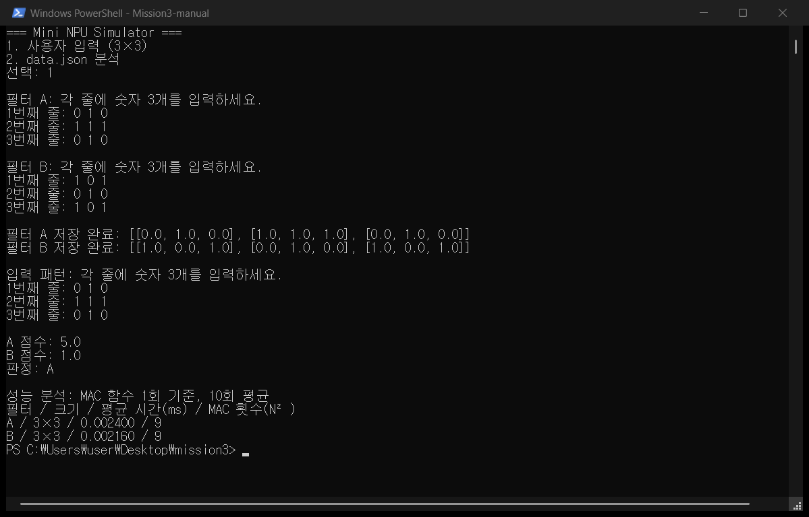
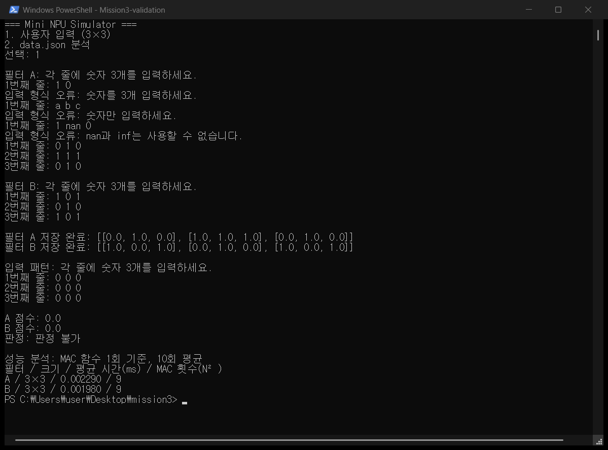
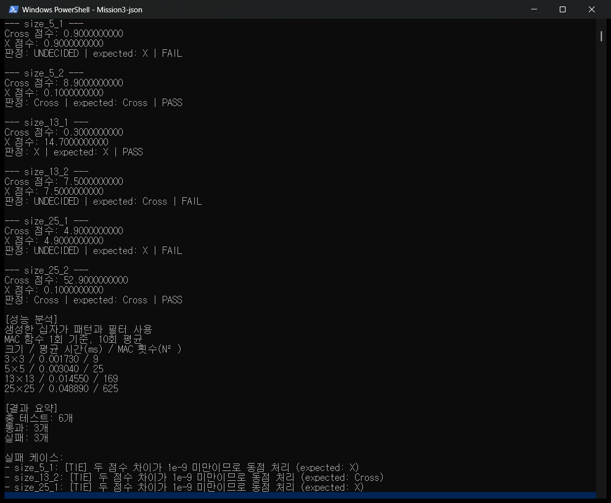

# 코디세이 미션 3 — Mini NPU Simulator

십자가와 X를 숫자 배열로 표현하고, 필터와의 MAC 점수를 비교하는 프로그램이다.
Python 3.8 이상에서 실행할 수 있으며 외부 라이브러리는 사용하지 않았다.

## 실행 방법

`main.py`와 `data.json`을 같은 폴더에 두고 실행한다.

```powershell
py main.py
```

환경에 따라 `python main.py`로 실행해도 된다.
메뉴에서 `1`은 3×3 직접 입력, `2`는 JSON 일괄 분석이다.

## 실습 과정

### 1. 배열을 만들고 MAC 점수 계산하기

색칠된 칸은 1, 빈칸은 0으로 표현했다. 십자가 필터 A와 X 필터 B는 다음과 같다.

```text
필터 A        필터 B
0 1 0         1 0 1
1 1 1         0 1 0
0 1 0         1 0 1
```

처음에는 이 배열들을 코드에 넣고 계산부터 확인했다.
`matrix[행][열]`로 같은 위치에 접근하고, 곱한 값을 점수에 누적했다.

```python
score = 0.0
for row in range(size):
    for col in range(size):
        score += pattern[row][col] * filter_data[row][col]
```

**이 미션에서는 MAC 점수가 높을수록 해당 필터와 유사하다고 판단한다.**
필터가 강조하는 위치에 입력값이 클수록 곱의 합도 커지기 때문이다.
다만 이 점수는 가중치 크기에도 영향을 받는 내적이므로, 모든 입력에 대해 정규화된 유사도를 뜻하지는 않는다.

십자가를 입력했을 때 A는 5.0, B는 1.0으로 계산되어 A로 판정되는 것을 확인했다.
3×3 성능 표에는 A·B 필터 각각의 평균 시간과 필터당 MAC 횟수 9를 표시했다.



### 2. 키보드 입력과 재입력 처리하기

배열을 직접 적어 두던 부분을 `read_matrix()` 함수로 바꾸었다.
한 행씩 입력받아 `split()`으로 나누고 `float()`로 변환한 뒤, 숫자가 정확히 3개인지 확인했다.
숫자 파싱 실패와 개수 오류는 같은 행을 다시 입력받으며, `nan`과 `inf`도 거부한다.

예를 들어 `1 0`을 입력하면 “숫자를 3개 입력하세요.”라고 안내한다.
`a b c`는 “숫자만 입력하세요.”라는 안내 뒤 다시 입력받는다.
아래 실행에서는 잘못된 입력을 수정한 뒤 영행렬을 패턴으로 넣어, 두 점수가 모두 0인 경우도 확인했다.



### 3. JSON에서 크기별 필터 선택하기

파일은 실행 위치와 관계없이 `main.py`가 있는 폴더에서 찾는다.
JSON의 `filters`, `patterns` 구조를 확인하고, 각 패턴 이름에서 크기를 읽었다.
예를 들어 `size_13_2`는 `filters["size_13"]`의 필터 두 개와 비교한다.

계산 전에 입력과 필터 모두 N행·N열인지, 각 원소가 숫자인지 검사한다.
잘못된 케이스는 `[DATA]`로 기록하고 다음 케이스를 계속 처리한다.
필터 키가 없으면 사용 가능한 키를 함께 안내하며, 패턴 이름 오류에는 `size_5_1` 같은 예시를 출력한다.

라벨은 다음과 같이 통일했다. 앞뒤 공백과 영문 대소문자도 처리한다.

| 입력 라벨 예시 | 표준 라벨 |
|---|---|
| `+`, `cross`, `Cross`, `CROSS` | `Cross` |
| `x`, `X` | `X` |

허용되지 않은 라벨에는 허용 예시를 출력한다.
`normalize_label()`로 분리해 필터 키와 `expected`에 같은 규칙을 재사용하고, 별도로 검사할 수 있게 했다.

### 4. 점수 비교와 동점 처리하기

두 모드에 같은 `EPSILON = 1e-9`를 적용했다.

```python
if abs(score_a - score_b) < EPSILON:
    result = "판정 불가"
```

`0.3`과 `0.30000000000000004`처럼 소수 표현에서 생기는 작은 차이를 승패로 처리하지 않기 위해서다.
`1e-9`는 과제의 권장 기준을 따랐으며, 현재 데이터의 점수 규모에서 이런 오차를 동점으로 묶는 절대 허용오차다.
차이가 정확히 `1e-9`이면 동점이 아니다. 입력값 규모가 크게 달라지면 이 기준도 다시 검토해야 한다.

직접 입력 모드는 임의의 두 필터를 A/B로 부르므로 동점을 “판정 불가”로 표시한다.
JSON 모드는 표준 라벨과 기대 정답을 비교하므로 같은 상태를 `UNDECIDED`로 표시한다.
`expected`는 Cross 또는 X이기 때문에, `UNDECIDED`는 기대 정답과 일치하지 않아 FAIL로 집계된다.

## 결과 리포트

### 원본 data.json 분석

총 6개 중 **3개 PASS, 3개 FAIL**을 확인했다.
아래 점수는 읽기 편하게 소수 첫째 자리로 정리했다. 실제 판정은 반올림 전 점수로 수행한다.

| 케이스 | Cross 점수 | X 점수 | expected | 판정 | 결과 |
|---|---:|---:|---|---|---|
| size_5_1 | 0.9 | 0.9 | X | UNDECIDED | FAIL |
| size_5_2 | 8.9 | 0.1 | Cross | Cross | PASS |
| size_13_1 | 0.3 | 14.7 | X | X | PASS |
| size_13_2 | 7.5 | 7.5 | Cross | UNDECIDED | FAIL |
| size_25_1 | 4.9 | 4.9 | X | UNDECIDED | FAIL |
| size_25_2 | 52.9 | 0.1 | Cross | Cross | PASS |

세 실패는 모두 `[TIE]`로, 점수 차이가 허용오차보다 작아서 발생했다.
`expected`에 맞추려고 동점에서 한쪽을 선택하면 정해진 비교 정책을 어기므로 그대로 기록했다.
라벨 정규화는 표기 차이로 인한 실패를 막지만, 실제 점수가 동점인 문제까지 해결하지는 않는다.

실패 원인은 다음 세 종류로 구분했다.

| 태그 | 의미 | 확인할 부분 |
|---|---|---|
| `[DATA]` | 데이터·스키마 오류 | 키, 라벨, 배열 크기, 원소 자료형 |
| `[TIE]` | 허용오차 안의 동점 | 반올림 전 점수 차이와 epsilon |
| `[MISMATCH]` | 승자는 있지만 기대 정답과 다름 | 필터 가중치, 입력 데이터, expected, 계산 로직 |

원본 데이터에서는 `[DATA]`와 `[MISMATCH]`가 없었다.
행·열 개수 오류, 누락된 필터와 expected, 잘못된 라벨을 넣은 별도 검증에서는 `[DATA]`로 집계되고 나머지 케이스가 계속 처리되는 것을 확인했다.



### 성능 측정과 시간 복잡도

측정 환경은 Windows 11, Intel Core i7-12650H, CPython 3.14.5이다.
아래 표는 같은 크기의 십자가 패턴과 필터를 생성해 MAC 함수 1회 실행 시간을 10번 측정한 평균이다.
`time.perf_counter()`를 MAC 호출 직전과 직후에 사용하고, 초 단위 결과에 1000을 곱해 ms로 변환했다.
배열 생성, 파일 읽기, 키보드 입력, 출력은 측정 구간에서 제외했다.

| 크기 | 평균 시간(ms), 10회 | 필터 하나의 MAC 횟수 |
|---|---:|---:|
| 3×3 | 0.001730 | 9 |
| 5×5 | 0.003040 | 25 |
| 13×13 | 0.014550 | 169 |
| 25×25 | 0.048890 | 625 |

N행에서 각각 N칸을 곱하고 더하므로 연산 횟수는 N²이며, 시간 복잡도는 **O(N²)**이다.
두 필터를 비교하면 2N²번이지만 상수 2를 제외한 복잡도는 같다.
MAC 함수가 추가로 사용하는 누적 변수와 인덱스의 공간은 O(1), 입력과 필터를 보관하는 공간은 O(N²)이다.

시간은 대략 `T(N) ≈ c × N² + d`로 생각할 수 있다. c는 위치당 처리 비용, d는 함수 호출과 측정 등의 고정 비용이다.
고정 비용이 작다고 가정하면 25×25에서 1000×1000으로 커질 때 연산 구간은 약 `(1000/25)² = 1600`배가 된다.
이는 연산량에 따른 예측이며 실제 1000×1000 측정값은 아니다.
작은 배열은 호출 비용과 타이머 오차의 비중이 커서 측정 시간이 N² 비율과 정확히 맞지 않을 수 있다.
Python 버전, CPU 성능, 백그라운드 작업도 시간에 영향을 주므로 표의 수치는 해당 실행 환경에서의 결과로 해석했다.

## 확장할 때 고려할 점

### 라벨을 추가하려면

기존 Cross의 다른 표기만 추가하는 경우에는 `normalize_label()`의 허용값을 늘리고 정규화 테스트를 추가하면 된다.
새 모양인 Y까지 판별하려면 다음 작업이 함께 필요하다.

1. `normalize_label()`에 Y의 표준 라벨과 허용 표기를 등록한다.
2. 각 크기의 Y 필터와 Y를 정답으로 갖는 패턴을 JSON에 추가하고 크기 검사를 적용한다.
3. Cross/X 두 개를 고정해서 계산하는 부분을 모든 필터의 점수를 계산하도록 변경한다.
4. 최고 점수와 나머지 점수를 비교해 epsilon 이내의 최고 점수가 여러 개면 UNDECIDED로 처리한다.
5. Y 정답, 기존 Cross/X, 동점, 미등록 라벨을 검사하고 총/통과/실패 집계도 확인한다.

현재 제출 코드는 Cross와 X 두 종류를 지원한다.

### 1000×1000에서는

필터 하나에 MAC 100만 번, 두 필터에는 200만 번이 필요하다.
반복 측정까지 하면 계산량이 더 늘고, Python 반복문 실행과 리스트 접근 비용도 커진다.
원소 하나를 연속된 64비트 실수로 저장해도 배열 하나는 약 8MB, 패턴 하나와 필터 두 개는 약 24MB가 필요하다.
Python의 2차원 리스트에는 참조와 숫자 객체의 오버헤드가 있고, JSON 원문을 읽는 메모리도 별도로 사용한다.
객체 공유 여부에 따라 실제 메모리 사용량은 달라진다.

최적화는 먼저 중복 복사를 줄이고 행을 지역 변수에 저장해 반복적인 인덱스 접근을 줄이는 것부터 시도할 수 있다.
표준 라이브러리 `array('d')`로 1차원 연속 저장을 하면 메모리 사용을 줄이는 데 도움이 된다.
타일 단위로 나누는 블로킹은 같은 데이터를 여러 필터에서 재사용할 때 검토할 수 있지만, 현재처럼 한 번 순회하는 내적에서는 추가 반복문 비용 때문에 빨라진다고 보장할 수 없다.

여러 패턴을 병렬 처리한다면 `multiprocessing`으로 작업을 나눌 수 있다. 이때 프로세스 생성과 배열 전달 비용을 함께 측정해야 한다.
일반적인 GIL 활성 CPython에서는 CPU 계산을 `threading`으로 나누는 것만으로 병렬 가속을 기대하기 어렵다. free-threaded 빌드는 별도 조건이다.
이 제약은 [Python threading 문서](https://docs.python.org/3.14/library/threading.html#gil-and-performance-considerations)에서 확인했다.
이 최적화들은 개선 방향이며 현재 제출 코드에는 적용하지 않았다.

### CPU와 NPU의 차이

이 프로그램은 CPU에서 Python 이중 반복문을 한 스레드로 실행하며 MAC 원리를 확인한다.
CPU도 여러 코어와 SIMD를 활용할 수 있으므로 CPU 자체가 항상 직렬로만 동작하는 것은 아니다.
현재 코드에서 먼저 확인할 병목은 Python 반복문과 객체 접근 비용이다.

NPU는 많은 MAC 연산을 병렬 처리하도록 설계된 연산 장치를 사용한다.
하지만 연산 장치에 데이터를 충분히 공급하지 못하면 메모리 전송이 병목이 된다.
따라서 큰 작업에서는 데이터 재사용과 전송량을 먼저 확인하고, 타일링과 병렬 배치를 함께 조정해야 한다.
Intel의 [NPU 구조 설명](https://intel.github.io/intel-npu-acceleration-library/npu.html)은 병렬 연산과 SRAM·DRAM 사이 전송 감소의 역할을 설명한다.
이번 실습의 시간 표는 CPU에서 실행한 Python 코드의 측정값이며 실제 NPU 성능을 나타내지 않는다.
